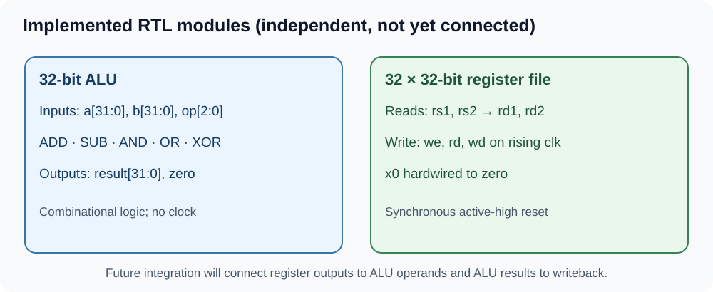
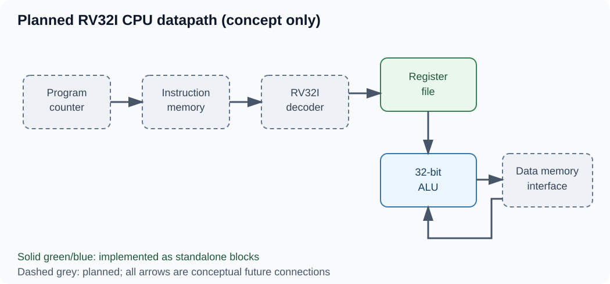
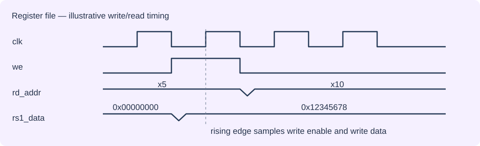
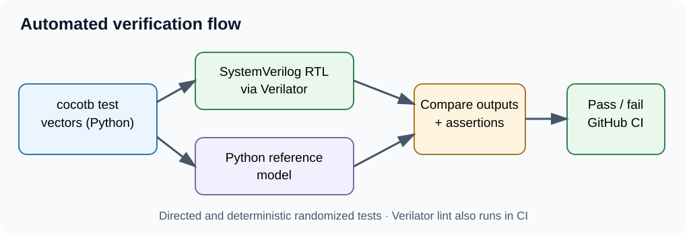

# RISC-V SoC Verification

*A from-scratch RISC-V processor in SystemVerilog with cocotb verification — under development.*

[](https://github.com/RianaMalhotra/riscv-soc-verification/actions/workflows/rtl-ci.yml)


This project incrementally implements and verifies an RV32I-based processor using SystemVerilog and Python-based cocotb tests. **The ALU, register file, and arithmetic-subset decoder are implemented and independently verified; a complete CPU and SoC are not yet implemented.** The goal is a modular, well-tested design with reproducible automated verification.

---

## 1. Project Overview

<table>
<tr><td width="51%" valign="top">

This repository develops a 32-bit RISC-V CPU and eventually a small SoC, entirely in simulation. Work is organized into milestones, starting with independent RTL blocks before CPU integration.

The focus is clean hardware design, directed and randomized cocotb verification, and continuous integration with GitHub Actions.

</td><td valign="top">

**Current Status**

- [x] **Milestone 1:** 32-bit ALU — implemented and verified
- [x] **Milestone 2:** 32 × 32-bit register file — implemented and verified
- [x] **Milestone 3:** RV32I arithmetic instruction decoder — implemented and verified
- [ ] **Milestone 4:** CPU datapath integration
- [ ] **Milestone 5:** Control and hazard handling (if needed)
- [ ] **Milestone 6:** Instruction and data memory
- [ ] **Milestone 7:** Top-level SoC and executable test programs

</td></tr>
</table>

## 2. Architecture

<table>
<tr><th width="50%">Current Implementation (Individual Modules)</th><th>Planned CPU Datapath (Conceptual)</th></tr>
<tr><td valign="top">

Three RTL modules exist and are verified **independently**.



**Instruction decoder:** 32-bit instruction → register indices, sign-extended immediate, ALU operation, write enable, and illegal-instruction flag.

</td><td valign="top">

The planned datapath is **not yet integrated or executing instructions**.



Program counter → instruction memory → decoder → register file → ALU → memory/writeback. Interconnections are conceptual.

</td></tr>
</table>

## 3. How It Works

### ALU

The combinational 32-bit ALU supports the following operations. Its `zero` output is asserted when the result is zero.

| `op` | Operation | Description |
|:---:|---|---|
| `000` | ADD | `a + b` |
| `001` | SUB | `a - b` |
| `010` | AND | `a & b` |
| `011` | OR | `a \| b` |
| `100` | XOR | `a ^ b` |

### Register File

The 32 × 32-bit register file has two asynchronous read ports and one synchronous write port. Writes occur on a rising clock edge when enabled. Register `x0` always reads zero and ignores writes.

**Illustrative timing diagram (not a captured simulator trace):**



### RV32I Instruction Decoder

The combinational decoder extracts register addresses and sign-extends the I-type immediate. It generates ALU control, immediate selection, register write enable and an `illegal` signal.

| Instruction | Type | `alu_op` | Description |
|---|:---:|:---:|---|
| ADD | R | `000` | `rd = rs1 + rs2` |
| SUB | R | `001` | `rd = rs1 - rs2` |
| AND | R | `010` | `rd = rs1 & rs2` |
| OR | R | `011` | `rd = rs1 \| rs2` |
| XOR | R | `100` | `rd = rs1 ^ rs2` |
| ADDI | I | `000` | `rd = rs1 + imm` |
| ANDI | I | `010` | `rd = rs1 & imm` |
| ORI | I | `011` | `rd = rs1 \| imm` |
| XORI | I | `100` | `rd = rs1 ^ imm` |

Unsupported encodings assert `illegal` and disable register writes. Loads, stores, branches, jumps, shifts and full RV32I execution remain future work.

## 4. Verification Strategy

We use cocotb to drive hardware inputs and compare results against Python reference behavior, with Verilator providing RTL simulation. GitHub Actions runs automated lint and regression checks.

**Verification flow**



- Directed and seeded randomized tests for ALU, register file, and decoder
- Register file reset, read/write, timing, and immutable-`x0` checks
- Decoder valid/invalid encoding and immediate sign-extension checks
- GitHub Actions regression on pushes and pull requests
- Functional coverage metrics and additional assertions are **planned**, not currently claimed

---

## Detailed Engineering Documentation

## At a glance

| | |
| --- | --- |
| **Focus** | RTL design, digital verification, RISC-V fundamentals, future DFT/DFX exploration |
| **Implemented hardware** | 32-bit ALU; 32-register file; RV32I arithmetic-subset decoder |
| **Verification** | Directed + seeded randomized cocotb tests with Python reference models |
| **Automation** | Verilator lint and simulation, GNU Make, GitHub Actions CI |
| **Hardware required** | None—runs entirely in software |
| **Current milestone** | Instruction decoder merged and verified; CPU integration next |

## Architecture

### 1. Implemented modules and their interfaces

The ALU and register file shown below exist in the repository today, alongside the independently verified arithmetic-subset decoder. The dotted line is a *conceptual future datapath connection*, **not a connection implemented in RTL**.


**How the pieces will eventually work together:** An instruction will select two source registers. Their values will feed the ALU, which computes a result. Control logic will decide whether that result is written back to a destination register. **Instruction decoding for nine arithmetic instructions is implemented independently; control integration and datapath interconnections have not been implemented yet.**

### 2. Planned processor architecture (future work)


The planned diagram is **architectural intent**, not a claim that instructions can currently execute.

## How the implemented hardware works

### Arithmetic Logic Unit (ALU)

[`rtl/core/alu.sv`](rtl/core/alu.sv) is a **combinational** 32-bit datapath block: changing its inputs changes its outputs without waiting for a clock. It takes two 32-bit operands and a three-bit operation selector.

| `op` | Operation | Behavior |
| --- | --- | --- |
| `000` | ADD | `a + b`, wrapped to 32 bits |
| `001` | SUB | `a - b`, wrapped to 32 bits |
| `010` | AND | Bitwise AND |
| `011` | OR | Bitwise OR |
| `100` | XOR | Bitwise XOR |
| `101–111` | Default | Result is zero |

The `zero` output is asserted whenever `result == 0`. The three-bit `op` values are **internal ALU control codes**, not RISC-V instruction encodings.

**Example:** With `a = 7`, `b = 5`, and `op = 000`, the ALU produces `result = 12` and `zero = 0`.

### Register file

[`rtl/core/register_file.sv`](rtl/core/register_file.sv) stores the values that a future processor would use as its architectural integer registers.

- **32 registers, 32 bits each:** `x0` through `x31`.
- **Two asynchronous read ports:** `rs1` and `rs2` select registers; `rd1` and `rd2` expose their values without a clock edge.
- **One synchronous write port:** If `we = 1`, `wd` is stored at `rd` on the **rising edge** of `clk`.
- **Hardwired zero:** Reads from `x0` always return zero; writes to `x0` are ignored, as required by RISC-V.
- **Synchronous active-high reset:** `rst` clears the storage on a rising edge. Clearing all registers is a **project-specific simulation/design choice**, not an RV32I architectural requirement.

**Example:** Write `0x12345678` to `x1` with `we = 1`; after the next rising edge, selecting `rs1 = 1` returns `0x12345678`. Selecting `rs2 = 0` still returns zero.

### Instruction decoder (Milestone 3)

[`rtl/core/instruction_decoder.sv`](rtl/core/instruction_decoder.sv) decodes a **limited RV32I arithmetic subset**: R-type `ADD`, `SUB`, `AND`, `OR`, `XOR` and I-type `ADDI`, `ANDI`, `ORI`, `XORI`. It extracts register indices, sign-extends the I-immediate, and emits ALU operation, immediate-select, register-write and illegal-instruction signals. Unsupported encodings assert `illegal` and disable writes. **Loads, stores, branches, jumps, shifts and a complete CPU remain unimplemented.**

## Verification: how correctness is checked

Rather than relying on visual waveform inspection alone, each module is tested by a **Python reference model** that independently computes the expected output and compares it to the simulated RTL.


| Module | Verification performed |
| --- | --- |
| **ALU** | All 8 selector values, boundary operands, 200 deterministic random operand pairs, output and zero-flag comparisons |
| **Register file** | Reset, immutable `x0`, `x1`/`x31` boundaries, two independent reads, write enable, edge timing, overwrite, reset priority |
| **Decoder** | Directed and seeded randomized valid R/I instruction encodings, sign extension, register indices, control outputs, and rejection of unsupported encodings |
| **Register file randomized** | 500 seeded transactions against a software register model, then a 32 × 32 exhaustive read-address sweep |
| **CI** | RTL lint followed by all three cocotb suites on pushes and pull requests |

A passing GitHub Actions run demonstrates that **these particular checks passed for that commit**; it does **not** establish full ISA compliance, measured functional coverage, or silicon readiness. See [the verification plan](docs/verification_plan.md) for details.

## Technology stack

| Tool | Role in this project |
| --- | --- |
| **SystemVerilog** | Describes the combinational and sequential hardware in synthesizable RTL |
| **Verilator** | Lints RTL and compiles it into a fast software simulation |
| **Python + cocotb** | Drives hardware signals, creates test scenarios, and checks outputs |
| **GNU Make** | Provides repeatable local commands for linting and simulation |
| **GitHub Actions** | Runs automated checks for pushes and pull requests |
| **Git / GitHub** | Version control, issues, feature branches, pull requests, and review history |

This is **hardware design expressed as code**, not a Python emulation of a CPU. Python is the *verification environment*; SystemVerilog defines the hardware being tested.

## Run locally

**Prerequisites:** Verilator, GNU Make, a C++ compiler, and Python with `venv` support. CI uses Ubuntu's system Python and [the pinned cocotb dependency](requirements.txt) for simulator compatibility. A Linux environment (including WSL on Windows) is recommended.

```bash
git clone https://github.com/RianaMalhotra/riscv-soc-verification.git
cd riscv-soc-verification

python3 -m venv .venv
source .venv/bin/activate
python -m pip install -r requirements.txt

make lint                # Lint all three SystemVerilog modules
make test                # Run ALU, register-file, and decoder tests
make test-alu            # Run only ALU tests
make test-register-file  # Run only register-file tests
make test-decoder        # Run only decoder tests
```

No FPGA, development board, or other physical hardware is needed.

## Repository structure

```text
riscv-soc-verification/
├── .github/workflows/rtl-ci.yml    # Automated lint and regression
├── rtl/core/
│   ├── alu.sv                      # 32-bit combinational ALU
│   ├── register_file.sv            # 32 × 32-bit register file
│   └── instruction_decoder.sv     # RV32I arithmetic subset decoder
├── verification/cocotb/
│   ├── test_alu.py                 # ALU directed/random tests
│   ├── test_register_file.py       # Register-file tests
│   └── test_instruction_decoder.py # Decoder tests
├── docs/
│   ├── architecture.md             # Detailed design notes
│   └── verification_plan.md        # Test coverage by behavior
├── Makefile                         # Build/test entry points
├── requirements.txt                 # Python dependency
└── LICENSE
```

## Development roadmap

- [x] **Milestone 1 — ALU:** Implement 32-bit arithmetic/logic and Python verification.
- [x] **Milestone 2 — Register file:** Implement two-read/one-write 32-register storage and directed/randomized tests.
- [x] **Verification infrastructure:** Configure Verilator lint, cocotb regression, and passing CI for the implemented modules.
- [x] **Milestone 3 — RV32I decoder:** Implement and test a limited arithmetic instruction subset; additional instruction classes remain planned.
- [ ] **Milestone 4 — CPU datapath:** Add program counter, connect blocks, and execute a small RV32I subset in simulation.
- [ ] **Milestone 5 — Verification depth:** Add assertions, functional coverage metrics, and integration-level regression.
- [ ] **Milestone 6 — DFT/DFX exploration:** Prototype scan-chain and built-in self-test (BIST) mechanisms with fault-injection tests.

Follow progress through [GitHub Issues](https://github.com/RianaMalhotra/riscv-soc-verification/issues) and [Actions](https://github.com/RianaMalhotra/riscv-soc-verification/actions).

## Engineering decisions and limitations

- **Modular development:** Verify individual blocks before integrating a processor, so failures are easier to isolate.
- **Deterministic random tests:** Fixed seeds make failures reproducible.
- **Architectural vs implementation behavior:** `x0` semantics follow RV32I; clearing the register file on reset is a deliberate implementation choice.
- **Scope honesty:** No processor integration, FPGA deployment, measured functional coverage, or scan/BIST implementation is claimed at this stage.

## Author

**Riana Malhotra** · Computer Engineering, University of Toronto

## License

Distributed under the [MIT License](LICENSE).
