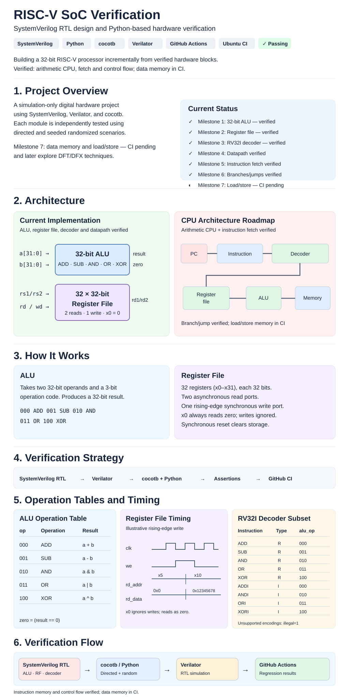

<p align="center"></p>

> **Visual overview** 
---

# RISC-V SoC Design & Verification

[](https://github.com/RianaMalhotra/RVCore-RISC-V-Processor-Design-Verification/actions/workflows/rtl-ci.yml)


**Building and verifying the hardware building blocks of a 32-bit RISC-V processor—entirely in simulation.**

This project is a hands-on exploration of **digital RTL design, processor architecture, and hardware verification**. I implement synthesizable hardware modules in SystemVerilog, test their behavior against Python reference models with cocotb, and run automated regressions through GitHub Actions. The longer-term goal is a small RV32I-based CPU followed by design-for-test (DFT) experiments.

> **Current scope (October 2026):** A simulation-only, single-cycle RV32I-subset CPU integrates integer arithmetic/shifts/comparisons, branches/jumps, and byte/halfword/word loads and stores. A React/Vite visualizer replays recorded Verilator/cocotb execution. **Milestone 10 simulation verification has expanded to randomized streams, architectural scoreboards, and fault assertions; Milestone 11 adds standalone scan-chain, fault-injection, and LFSR/MISR BIST and signature-based fault-detection experiments.** This is not a complete RV32I-compliant SoC; system instructions, exceptions, interrupts, and external interfaces are not implemented.

## At a glance

| | |
| --- | --- |
| **Focus** | RTL design, digital verification, RISC-V fundamentals, standalone DFT/DFX experiments |
| **Implemented hardware** | 32-bit ALU; 32-register file; instruction decode/fetch; RV32I integer execution; branch/jump control; data memory; integrated CPU |
| **Verification** | Directed cocotb unit/integration tests; differential scoreboards, CPU fault assertions, scan-chain tests, modeled stuck-at output fault detection, and LFSR/MISR BIST verification |
| **Automation** | Verilator lint and simulation, GNU Make, GitHub Actions CI |
| **Hardware required** | None—runs entirely in software |
| **Current milestone** | Milestones 1–10 core simulation regression merged; Milestone 11 DFT/DFX experiments underway |

## Architecture

### 1. Implemented modules and their interfaces

These independently tested building blocks are now connected in the CPU integration modules. The illustration is a historical module-level view.


**How the pieces will eventually work together:** An instruction will select two source registers. Their values will feed the ALU, which computes a result. Control logic will decide whether that result is written back to a destination register. **Instruction decoding, control, and arithmetic interconnections are implemented in RTL.**

### 2. Planned processor architecture (future work)


The planned diagram is an architectural roadmap. The current CPU already executes arithmetic, branches and jumps, with load/store integration under review.

## How the implemented hardware works

### Arithmetic Logic Unit (ALU)

[`rtl/core/alu.sv`](rtl/core/alu.sv) is a **combinational** 32-bit datapath block: changing its inputs changes its outputs without waiting for a clock. It takes two 32-bit operands and a three-bit operation selector.

| `op` | Operation | Behavior |
| --- | --- | --- |
| `000` | ADD | `a + b`, wrapped to 32 bits |
| `001` | SUB | `a - b`, wrapped to 32 bits |
| `010` | AND | Bitwise AND |
| `011` | OR | Bitwise OR |
| `100` | XOR | Bitwise XOR |
| `101–111` | Default | Result is zero |

The `zero` output is asserted whenever `result == 0`. The three-bit `op` values are **internal ALU control codes**, not RISC-V instruction encodings.

**Example:** With `a = 7`, `b = 5`, and `op = 000`, the ALU produces `result = 12` and `zero = 0`.

### Register file

[`rtl/core/register_file.sv`](rtl/core/register_file.sv) stores the values that a future processor would use as its architectural integer registers.

- **32 registers, 32 bits each:** `x0` through `x31`.
- **Two asynchronous read ports:** `rs1` and `rs2` select registers; `rd1` and `rd2` expose their values without a clock edge.
- **One synchronous write port:** If `we = 1`, `wd` is stored at `rd` on the **rising edge** of `clk`.
- **Hardwired zero:** Reads from `x0` always return zero; writes to `x0` are ignored, as required by RISC-V.
- **Synchronous active-high reset:** `rst` clears the storage on a rising edge. Clearing all registers is a **project-specific simulation/design choice**, not an RV32I architectural requirement.

**Example:** Write `0x12345678` to `x1` with `we = 1`; after the next rising edge, selecting `rs1 = 1` returns `0x12345678`. Selecting `rs2 = 0` still returns zero.

### Instruction decoder (Milestone 3)

[`rtl/core/instruction_decoder.sv`](rtl/core/instruction_decoder.sv) decodes a **limited RV32I arithmetic subset**: R-type `ADD`, `SUB`, `AND`, `OR`, `XOR` and I-type `ADDI`, `ANDI`, `ORI`, `XORI`. It extracts register indices, sign-extends the I-immediate, and emits ALU operation, immediate-select, register-write and illegal-instruction signals. Unsupported encodings assert `illegal` and disable writes. **This legacy decoder covers only the arithmetic subset; later integrated CPU modules add branches, jumps, loads/stores, and extended integer execution.**

## Verification: how correctness is checked

Rather than relying on visual waveform inspection alone, each module is tested by a **Python reference model** that independently computes the expected output and compares it to the simulated RTL.


| Module | Verification performed |
| --- | --- |
| **ALU** | All 8 selector values, boundary operands, 200 deterministic random operand pairs, output and zero-flag comparisons |
| **Register file** | Reset, immutable `x0`, `x1`/`x31` boundaries, two independent reads, write enable, edge timing, overwrite, reset priority |
| **Decoder** | Directed and seeded randomized valid R/I instruction encodings, sign extension, register indices, control outputs, and rejection of unsupported encodings |
| **Register file randomized** | 500 seeded transactions against a software register model, then a 32 × 32 exhaustive read-address sweep |
| **CI** | RTL lint followed by both cocotb suites on pushes and pull requests |

A passing GitHub Actions run demonstrates that **the checks for that commit passed**; it does **not** establish full ISA compliance, coverage closure, or silicon readiness. The Milestone 10 scoreboard tracks exercised operation categories, **not** formal functional-coverage closure. See [the Milestone 10 verification plan](docs/m10_verification.md) and [the original verification plan](docs/verification_plan.md). See [the verification plan](docs/verification_plan.md) for details.

## DFT/DFX experiments (Milestone 11)

- [Parameterized scan chain](rtl/dft/scan_chain.sv): 8-bit default with functional capture, serial shift, scan-out, and synchronous reset; verified by `make test-scan-chain`.
- [Scan stuck-at fault model](rtl/dft/scan_fault_harness.sv): selectable bit and stuck-at-0/1 on the **observable output**. The test sensitizes and detects all 16 modeled output faults (8 positions × 2 polarities), and checks non-sensitizing patterns. Run `make test-scan-stuck-at`.
- [LFSR/MISR BIST engine](rtl/dft/bist_engine.sv): deterministic 8-bit pseudo-random patterns and response-signature compaction against a toy combinational circuit, checked cycle-by-cycle with an independent Python model. Run `make test-bist`.
- [BIST signature fault detection](rtl/dft/bist_fault_engine.sv): injects 16 response stuck-at-0/1 fault cases into a toy circuit, checks MISR signatures against a reference model, and reports detected versus aliased faults. Run `make test-bist-faults`.
- [BIST fault detection notes](docs/m11_bist_fault_detection.md) · [BIST details and limitations](docs/m11_bist.md) · [Fault model and limitations](docs/m11_fault_injection.md) · [Scan-chain design notes](docs/m11_scan_chain.md).

These are standalone educational experiments. The CPU is **not scan-inserted**, and modeled output-fault detection and toy-circuit BIST are **not** equivalent to silicon fault coverage, internal stuck-at coverage, CPU BIST integration, or ATPG qualification.

## Technology stack

| Tool | Role in this project |
| --- | --- |
| **SystemVerilog** | Describes the combinational and sequential hardware in synthesizable RTL |
| **Verilator** | Lints RTL and compiles it into a fast software simulation |
| **Python + cocotb** | Drives hardware signals, creates test scenarios, and checks outputs |
| **GNU Make** | Provides repeatable local commands for linting and simulation |
| **GitHub Actions** | Runs automated checks for pushes and pull requests |
| **Git / GitHub** | Version control, issues, feature branches, pull requests, and review history |

This is **hardware design expressed as code**, not a Python emulation of a CPU. Python is the *verification environment*; SystemVerilog defines the hardware being tested.

## Run locally

**Prerequisites:** Verilator, GNU Make, a C++ compiler, and Python with `venv` support. CI uses Ubuntu's system Python and [the pinned cocotb dependency](requirements.txt) for simulator compatibility. A Linux environment (including WSL on Windows) is recommended.

```bash
git clone https://github.com/RianaMalhotra/RVCore-RISC-V-Processor-Design-Verification.git
cd RVCore-RISC-V-Processor-Design-Verification

python3 -m venv .venv
source .venv/bin/activate
python -m pip install -r requirements.txt

make lint                # Lint the SystemVerilog modules
make test                # Run all unit and integration tests
make test-alu            # Run only ALU tests
make test-register-file  # Run only register-file tests
make test-decoder        # Run only decoder tests
make test-rv32i-differential # M10 seeded reference-model scoreboard
make test-scan-chain       # M11 functional capture and serial scan
make test-scan-stuck-at    # M11 modeled stuck-at-0/1 fault detection
make test-bist           # M11 LFSR test patterns and MISR signatures
make test-bist-faults    # M11 response stuck-at fault signature detection
make trace               # Export the RTL-driven visualizer trace
```

No FPGA, development board, or other physical hardware is needed.

## Repository structure

```text
riscv-soc-verification/
├── .github/workflows/rtl-ci.yml    # Automated lint and regression
├── rtl/core/
│   ├── alu.sv                      # 32-bit combinational ALU
│   ├── register_file.sv            # 32 × 32-bit register file
│   └── instruction_decoder.sv     # RV32I arithmetic subset decoder
├── verification/cocotb/
│   ├── test_alu.py                 # ALU directed/random tests
│   ├── test_register_file.py       # Register-file tests
│   └── test_instruction_decoder.py # Decoder tests
├── docs/
│   ├── architecture.md             # Detailed design notes
│   └── verification_plan.md        # Test coverage by behavior
├── Makefile                         # Build/test entry points
├── requirements.txt                 # Python dependency
└── LICENSE
```

## Development roadmap

- [x] **Milestone 1 — ALU:** 32-bit arithmetic/logic with cocotb verification.
- [x] **Milestone 2 — Register file:** 32 registers, dual reads, synchronous write, directed/randomized tests.
- [x] **Milestone 3 — RV32I decoder:** Arithmetic instruction decoding and illegal-instruction tests.
- [x] **Milestone 4 — CPU datapath:** PC, ALU, register file and writeback integration.
- [x] **Milestone 5 — Instruction memory:** Automatic fetch and stored-program execution.
- [x] **Milestone 6 — Control flow:** Branches, JAL and JALR.
- [x] **Milestone 7 — Data memory:** Byte/halfword/word loads and stores; CI verified.
- [x] **Milestone 8 — RV32I integer execution:** Shifts, comparisons, LUI/AUIPC, and unified CPU integration (subset limitations noted below).
- [x] **Milestone 9 — [Interactive CPU visualizer](https://github.com/RianaMalhotra/RVCore-RISC-V-Processor-Design-Verification/issues/14):** Recorded RTL execution traces, React/Vite step-through datapath and register viewer; richer memory inspection remains future work.
- [ ] **Milestone 10 — Verification depth (in progress, [PR #17](https://github.com/RianaMalhotra/RVCore-RISC-V-Processor-Design-Verification/pull/17)):** Seeded integer differential scoreboard, operation stimulus counts, negative tests; CPU-level scoreboard, assertions and coverage closure still planned.
- [ ] **Milestone 11 — DFT/DFX exploration:** Scan chains, BIST and fault-injection experiments.
- [ ] **Milestone 12 — Final validation and demo:** End-to-end demonstration, reproducible instructions and portfolio documentation.

**Status: 9 of 12 milestones merged.** Milestone 10 is under review; the visualizer replays measured simulator traces rather than emulating the CPU in JavaScript.
## Engineering decisions and limitations

- **Modular development:** Verify individual blocks before integrating a processor, so failures are easier to isolate.
- **Deterministic random tests:** Fixed seeds make failures reproducible.
- **Architectural vs implementation behavior:** `x0` semantics follow RV32I; clearing the register file on reset is a deliberate implementation choice.
- **Scope honesty:** The integrated CPU and trace visualizer run in simulation; no FPGA deployment, ISA compliance certification, functional-coverage closure, or scan/BIST implementation is claimed.

## Author

**Riana Malhotra** · Computer Engineering, University of Toronto

## License

Distributed under the [MIT License](LICENSE).

## Milestone 4 — Single-cycle arithmetic datapath (completed)

The `cpu_datapath` top-level connects the existing **RV32I arithmetic-subset decoder → 32 × 32-bit register file → ALU → register writeback**. It adds a 32-bit program counter starting at zero and advancing by four bytes for each supported instruction. Unsupported instructions assert `illegal` and latch `halted`, freezing the PC and preventing subsequent writes until reset.

**This is a CPU integration prototype, not a complete RV32I processor.** The standalone `cpu_datapath` accepts externally supplied instructions; Milestone 5 adds instruction memory through `cpu_system`. Branches, jumps, loads/stores, and data memory are not yet present. The original uploaded reference JPEG remains available in `docs/images/reference.jpeg`. The updated SVG overview above reflects the completed datapath milestone while retaining timing and verification diagrams.

```text
External instruction[31:0]
        │
        ▼
   RV32I decoder ────── control ───────────────┐
        │                                      │
        ▼                                      ▼
  Register file ── rs1_value ───────────────► ALU
        │                                      │
        └─ rs2_value ── immediate mux ────────►│
                                               │
                    register writeback ◄───────┘
        PC: reset to 0, +4 per valid instruction; halt on illegal
```

Run `make test-cpu` for the end-to-end arithmetic program, register writeback, x0, illegal-instruction halt and reset checks. `make test` now includes the CPU suite. **CI results must pass before merging this milestone.**

## Milestone 5 — Instruction memory and automatic fetch (CI verified)

The new `cpu_system` top level connects a 64-word, read-only `instruction_memory` to the Milestone 4 arithmetic datapath. The PC is a **byte address**; the instruction memory uses `PC >> 2` to fetch 32-bit aligned words from `programs/arithmetic.hex`. An invalid or unaligned fetch returns an illegal zero word and halts the core.

The example program executes eight arithmetic instructions, writes results into registers, and stops on a zero-word sentinel. The cocotb system test verifies each fetched instruction's ALU result, sequential PC updates, halt behavior, and reset replay. Run `make test-system` or `make test` (all suites). The CI workflow already invokes `make test` and `make lint`, so the new suite is automatically included.

**Limits:** This is still an arithmetic-subset prototype, not a full RV32I processor. There is no branch/jump control flow, load/store, data memory, external bus, or interrupt support. The memory image is loaded for simulation with `$readmemh`.

## Milestone 6 — Conditional branches and jumps (completed, CI verified)

The new `cpu_system_control` top-level integrates a `cpu_control_flow` decoder/comparator with the instruction memory, arithmetic decoder, register file, and ALU. Supported control flow: **BEQ, BNE, BLT, BGE, BLTU, BGEU, JAL, JALR**. Branch offsets are signed B-type immediates, JAL uses a signed J-type offset, and JALR computes `(rs1 + signed immediate) & ~1`. Taken branches/jumps update the PC; untaken branches use `PC + 4`. JAL/JALR write `PC + 4` to `rd` (except `x0`). Illegal encodings and misaligned taken targets halt execution; misaligned targets do not commit link writes.

The stored `programs/control_flow.hex` executes a decrementing loop and skips an instruction with JAL. The cocotb suites `test_cpu_control_flow.py` and `test_cpu_system_control.py` test branch signedness, offsets, legal/illegal encodings, PC trace, and reset. Run `make test-control-flow`, `make test-control-system`, or `make test`.

**Scope:** This is still a small arithmetic-and-control-flow CPU prototype, not a complete RV32I core. Loads/stores, data memory, system instructions, exceptions, and interrupts are not implemented. The existing timing diagram remains a register-file timing illustration.

## Milestone 7 — Data memory and RV32I load/store (completed, CI verified)

Added `rtl/core/data_memory.sv`: 256-byte default little-endian data memory, supporting `LB`, `LBU`, `LH`, `LHU`, `LW`, `SB`, `SH`, and `SW`. Byte and halfword reads sign-extend or zero-extend as appropriate. Misaligned, out-of-range, or invalid accesses raise a fault and do not commit stores.

The new `rtl/core/cpu_system_memory.sv` integrates memory into the existing arithmetic/branch/jump CPU, computes effective addresses as `rs1 + signed 12-bit immediate`, and routes load data to register writeback. The existing CPU modules are retained for regression compatibility. The program `programs/load_store.hex` exercises stores and loads of all three sizes; cocotb unit and integration tests run with `make test-data-memory` and `make test-memory-system` (included in `make test`).

**Limitations:** This is a simulation-only CPU prototype. There is no bus, cache, MMU, exception handler, or full RV32I support yet. Invalid memory accesses halt the CPU instead of raising architecturally compliant exceptions.

## Milestone 9 — RTL execution visualizer (merged)

A React/Vite dashboard replays **observed Verilator/cocotb execution cycles** from the integrated RV32I integer program. The visualizer shows the PC, fetched instruction, decoded operation, active datapath, register writeback, and all 32 registers after each cycle. It supports step forward/backward, play/pause, reset, and timeline scrubbing. No separate CPU emulator is used.

From the repository root, after installing the existing simulation prerequisites:

```bash
make trace
cd visualizer
npm install
npm run dev
```

Open the local URL printed by Vite (normally http://127.0.0.1:5173). **Run `make trace` first**: the generated `visualizer/public/trace.json` is intentionally ignored by Git. CI checks trace generation, schema, and the production frontend build. The trace is a recorded simulation, **not live FPGA or ASIC execution**. This first demo uses `programs/rv32i_integer.hex`; additional programs and richer memory-state inspection are planned.

## Milestone 10 — Advanced verification (in progress)

[PR #17](https://github.com/RianaMalhotra/RVCore-RISC-V-Processor-Design-Verification/pull/17) adds an independent Python reference-model scoreboard for **21 supported RV32I integer operations**. The new cocotb suite exercises **1,701 directed operand-boundary comparisons**, **2,100 seeded randomized comparisons**, and **64 invalid/unsupported instruction checks**. A per-operation stimulus histogram and fixed seed (`0x20261025`) make the test reproducible. These numbers describe the **implemented test workload**, not verified pass counts or functional-coverage closure; PR CI must pass before merging.

Run from the feature branch with an activated Python environment:

```bash
make test-rv32i-differential  # Targeted integer reference-model verification
make test                    # Full regression, including the new suite
```

See [Milestone 10 verification methodology and limitations](docs/m10_verification.md). Next work: CPU-level architectural register/memory scoreboarding, branch and load/store scenarios, control assertions, and measured coverage closure.
